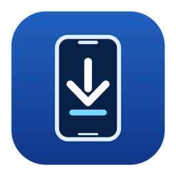

<p align="center">
  
</p>

<h1 align="center">IPA &amp; APK Installer</h1>

<p align="center">
  <strong>Install your own mobile builds straight from Finder.</strong><br>
  A native macOS menu bar app for signed iPhone, iPad, and Android packages.
</p>

<p align="center">
  <a href="https://github.com/Mahesh-Vanga/IPA-APK-Installer/releases/latest"><strong>Download</strong></a>
  · <a href="#quick-start">Quick start</a>
  · <a href="#build-from-source">Build from source</a>
  · <a href="docs/PRIVACY.md">Privacy</a>
</p>

<p align="center">
  <a href="https://github.com/Mahesh-Vanga/IPA-APK-Installer/actions/workflows/macos.yml"></a>
</p>

## Download

**macOS 14 or later** · **Apple silicon and Intel** · **MIT licensed**

| Download | How to install |
| --- | --- |
| [DMG](https://github.com/Mahesh-Vanga/IPA-APK-Installer/releases/download/v0.0.3/IPA-APK-Installer-0.0.3.dmg) | Open the disk image and drag the app into Applications. |
| [PKG](https://github.com/Mahesh-Vanga/IPA-APK-Installer/releases/download/v0.0.3/IPA-APK-Installer-0.0.3.pkg) | Open the package and follow the macOS Installer prompts. |

Both formats contain the same universal app. Use either one. If replacing a development build, fully quit it from the menu bar first. Release notes and SHA-256 checksums are on the [0.0.3 release page](https://github.com/Mahesh-Vanga/IPA-APK-Installer/releases/tag/v0.0.3).

## Quick start

1. **Connect and authorize a device.** Use the platform setup below.
2. **Drop one IPA or APK** onto the menu bar icon or into the app. This selects the file without installing it.
3. **Choose the target** and click **Install on Device**. Progress and errors stay in the installer.

| Device | Setup |
| --- | --- |
| iPhone or iPad | Install full Xcode, select it for command-line tools, and pair and unlock the device. Use an IPA signed and provisioned for that device. Enable Developer Mode where required. |
| Android | Install [Google Android SDK Platform-Tools](https://developer.android.com/tools/releases/platform-tools). Enable USB debugging or use an existing ADB connection, authorize this Mac, and select a signed standalone APK. |

Use **Refresh** if an authorized device is missing. The app does not re-sign builds, bypass device security, uninstall apps, or install split APK sets or Android App Bundles.

## Menu bar controls

| Action | Result |
| --- | --- |
| Hover or click the icon | Open the drop panel. |
| Drag the panel by its title | Detach it into a regular window. |
| Press **Command-Q** | Close windows and keep the drop target running. |
| Double-tap or secondary-click the icon | Open the menu to quit completely. |
| Open **Settings** | Set the close delay, toggle Diagnostics, manage launch at login, or check for updates. |

After the windows close, the app can hand the menu bar icon to a fresh process to release memory used by the interface. Your current file selection, target, and diagnostics carry over. The icon may briefly refresh.

## Privacy

Device installs work locally. The installer does not upload your packages or diagnostics, require an account, or check for updates in the background. It contacts the configured GitHub release source only when you ask it to check for updates.

## Build from source

```sh
bash test-core.sh
BUILD_UNIVERSAL=1 BUILD_PKG=1 bash build-dmg.sh
```

The tests use synthetic fixtures. Local packages are for development. See the [build and distribution guide](docs/BUILD.md) for Developer ID signing and notarization.

[Changelog](CHANGELOG.md) · [Privacy details](docs/PRIVACY.md) · [Contributing](CONTRIBUTING.md) · [Security reporting](SECURITY.md) · [MIT license](LICENSE)
